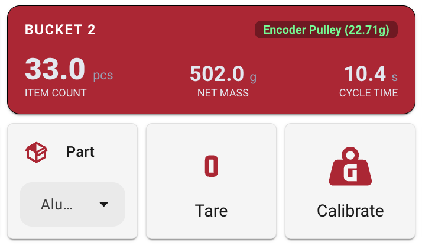
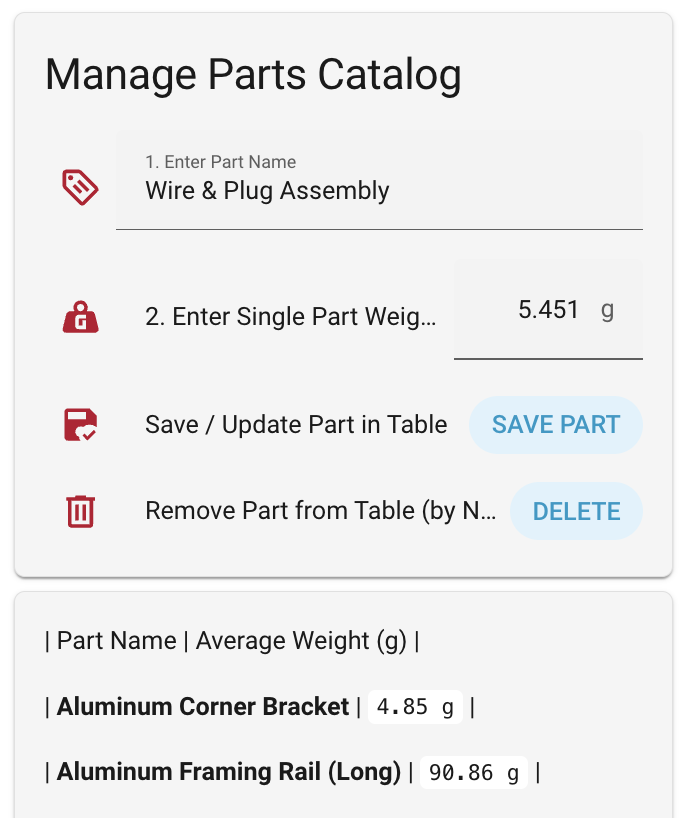
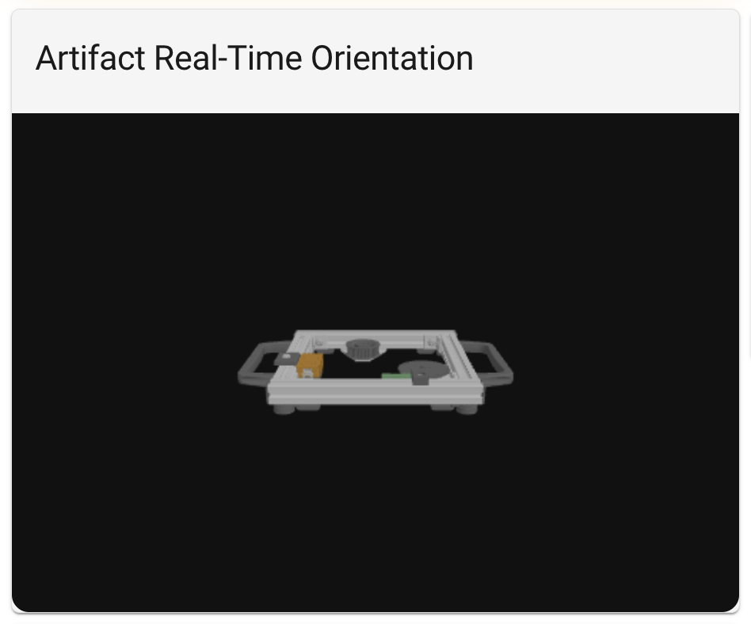
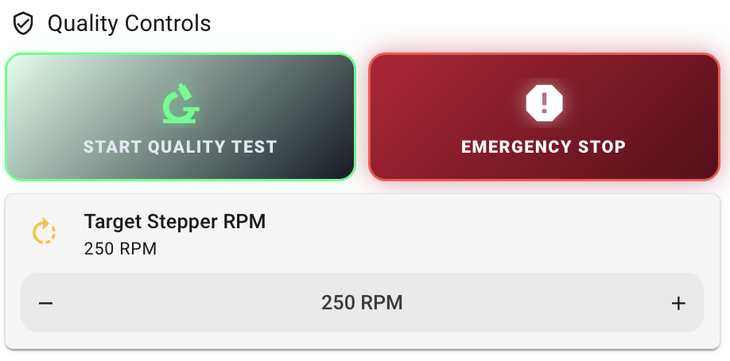

# Innovation Factory Cyber-Physical Assembly Testbed

A modular, scalable firmware and Home Assistant backend architecture for a multi-station manual assembly testbed. Each assembly station features **8 independent HX711 load cell bins** with real-time digital signal processing (DSP), dynamic part-weight catalog syncing, high-frequency `100ms` MQTT telemetry logging, real-time 3D artifact orientation (`25Hz` / `40ms`) and Bill of Materials (BOM) tracking across stations, and an automated optical encoder artifact quality verification system.

## Table of Contents

 1. [Repository Structure & File Reference](#repository-structure--file-reference)

 2. [Dashboard UI & Visual Overview](#dashboard-ui--visual-overview)

 3. [System Architecture & Core Subsystems](#system-architecture--core-subsystems)

 4. [Prerequisites](#prerequisites)

 5. [Step-by-Step Installation Guide](#step-by-step-installation-guide)

 6. [Standard Operating Procedures (SOP)](#standard-operating-procedures-sop)

 7. [Scaling the Testbed](#scaling-the-testbed)

 8. [Tunable Parameters & Engineering Reference](#tunable-parameters--engineering-reference)

 9. [Hardware Limitations & Physical Constraints](#hardware-limitations--physical-constraints)

10. [Hardware Best Practices](#hardware-best-practices)

     

## Repository Structure & File Reference

The repository mirrors the target `/config/` directory structure of a production Home Assistant instance:

```text
└── homeassistant/
    ├── configuration.yaml                    # Core HA config: enables packages, QC rig logic, stepper REST commands & artifact tracking
    ├── custom_templates/
    │   └── artifact_tracking.jinja           # Reusable Jinja2 macros for station part-consumption & BOM verification
    ├── packages/
    │   └── parts_catalog.yaml                # Self-contained Master Parts DB, scripts, dropdowns & auto-discovery automations
    ├── www/
    │   ├── artifact.glb                      # 3D GLTF/GLB model of the smart artifact for real-time dashboard rendering
    │   └── imu-visualizer.js                 # Custom Three.js WebGL card script for real-time 3D roll/pitch/yaw visualization
    ├── dashboards/
    │   ├── full-assy-line-dashboard.yaml     # Complete multi-view Lovelace dashboard for all stations & quality control
    │   ├── imu-visualizer.yaml               # Standalone Lovelace YAML for the 3D Artifact IMU Visualizer card
    │   ├── parts-catalog.yaml                # Standalone Lovelace YAML for the Master Parts Catalog manager card
    │   └── quality-control-card.yaml         # Standalone Lovelace YAML for the Quality Check HUD & tactile rig controls
    └── esphome/
        ├── assembly-station-1.yaml           # Station 1 ESP32 node definition (substitutions, Wi-Fi/OTA, includes common config)
        ├── assembly-01.yaml                  # Smart Artifact 01 ESP32 node definition (includes artifact_config.yaml)
        ├── madgwick_sensor.h                 # Custom C++ sensor header implementing FastMadgwick quaternion AHRS IMU fusion
        └── common/
            ├── assembly_station_config.yaml  # Shared station config: 8x load_cell_template includes & 100ms MQTT telemetry
            ├── load_cell_template.yaml       # Parameterized single load-cell DSP, Kalman filter & calibration template
            └── artifact_config.yaml          # Shared M5StickC Plus 2 config (MPU6886 IMU, BLE iBeacon, ST7789V LCD, Optical RPM)

```

### Component Breakdown

| File Path | Role in the Architecture | 
| ----- | ----- | 
| **`configuration.yaml`** | Loads the `packages/` directory, defines the stepper motor REST commands (`quality_test`, `stepper_stop`, `stepper_play_fur_elise`), evaluates sliding-window RPM quality checks, and instantiates the active artifact BOM tracker. | 
| **`custom_templates/artifact_tracking.jinja`** | Provides Jinja2 macros (`station_part_inventory`, `station_parts_picked`, `verify_artifact_bom`) that calculate real-time part consumption deltas across all 8 bins of the active station. | 
| **`packages/parts_catalog.yaml`** | Implements the event-driven Master Parts Database (`sensor.master_parts_catalog`), CRUD scripts, per-bin `input_select` helpers, and regex auto-discovery automations that push unit weights to ESPHome nodes. | 
| **`www/imu-visualizer.js` & `artifact.glb`** | Defines the `<imu-3d-card>` custom WebGL element using Three.js (`v0.160.0`) and `GLTFLoader` to auto-scale, center, and rotate `/local/artifact.glb` in real time using `YXZ` intrinsic Euler angles. | 
| **`esphome/madgwick_sensor.h`** | Implements the `FastMadgwick` C++ class (`beta = 0.1f`) using the fast inverse square root (`0x5f3759df`) algorithm to fuse raw `100Hz` accelerometer and gyroscope readings into quaternion-derived Roll, Pitch, and Yaw angles. | 
| **`esphome/common/load_cell_template.yaml`** | Parameterized package instantiated 8 times per station. Contains the HX711 driver, 9-sample median spike filter, adaptive 1D Kalman filter, flash-safe thermal drift tracker, and stability-gated item counter. | 
| **`esphome/common/assembly_station_config.yaml`** | Maps the 8 load cells to their physical ESP32 GPIO pins, staggers ADC polling intervals, and broadcasts a unified JSON telemetry payload over MQTT every `100ms` with UNIX millisecond timestamps. | 
| **`esphome/common/artifact_config.yaml`** | Shared firmware profile for the M5StickC Plus 2 smart artifact: manages `5s` startup gyro bias calibration, `40ms` (`25Hz`) MQTT & HA orientation streaming, BLE iBeacon broadcasting (`50ms`–`80ms`), ST7789V on-screen display, non-linear LiPo battery curve, and GPIO32 optical encoder RPM verification. | 

## Dashboard UI & Visual Overview

> **Note:** Place your screenshot images inside a `docs/images/` folder in the repository (or update the paths below to match your image filenames).

### 1. Station Load Cell & Bucket KPI Card (`dashboards/full-assy-line-dashboard.yaml`)

Each of the 8 load cells per station is rendered using a compact `#BA0C2F` KPI header (`custom:button-card`) paired with inline part assignment, Tare, and Calibrate controls:



### 2. Master Parts Catalog Manager (`dashboards/parts-catalog.yaml`)

Operators can add new parts, update unit weights in grams, or remove obsolete parts directly from the UI without reflashing any ESP32 nodes:



### 3. Real-Time 3D IMU Digital Twin (`dashboards/imu-visualizer.yaml`)

Streams `25Hz` Roll, Pitch, and Yaw telemetry from the artifact's MPU6886 IMU into an interactive Three.js WebGL canvas rendering `artifact.glb`:



### 4. Artifact Quality Verification HUD & Rig Controls (`dashboards/quality-control-card.yaml`)

Displays real-time pass/wait status alongside tactile controls for starting the optical RPM test, adjusting stepper target RPM, and triggering an immediate Emergency Stop:



## System Architecture & Core Subsystems

### 1. Multi-Stage Load Cell DSP Pipeline (`load_cell_template.yaml`)

Raw HX711 load cell readings are susceptible to ESP32 Wi-Fi current dips, bit-bang timing interrupts, ambient temperature drift, and operator hand pressure. Each load cell executes a 4-stage real-time filter pipeline directly on the station ESP32:

* **Staggered Polling & Spike Rejection (`load_raw`):** The 8 HX711 sensors per station are polled at staggered intervals (`93ms` to `107ms`) to prevent CPU lockups during `100ms` MQTT broadcasts. A 9-sample moving median filter discards momentary bit-shift glitches up to `400ms` long.

* **Adaptive 1D Kalman Filter (`load_mass`):** Dynamically switches process noise covariance ($Q$) between ultra-smooth resting tracking ($Q = 0.0005$) and instantaneous step response ($Q = 2.0$) when a weight change $> 1.2\text{ g}$ is confirmed for 3 consecutive ticks (`300ms`).

* **Flash-Safe Continuous Thermal & Creep Compensation:** Tracks an internal `thermal_anchor` in RAM. Continuous ambient temperature drift and mechanical strain-gauge creep are bled off at $0.5\%$ per tick without writing to ESP32 NVS flash memory. Maximum correction speeds are clamped to prevent fighting physical settling vibrations, completely eliminating stepped "dead zone" drift on the graphs.

* **"Hand-in-Bin" Stability Gate & Fractional Hysteresis (`l_item_count`):** Prevents false item-count spikes when an operator reaches into a bin. The item counter freezes whenever the bin weight is actively changing ($\Delta m \ge 0.5\text{ g}$) and only updates after the scale settles for 4 consecutive ticks (`800ms`), using a $\pm 0.60\text{ item}$ deadband to eliminate rounding flicker.

### 2. Smart Artifact Telemetry, IMU Fusion & On-Device Display (`artifact_config.yaml`)

Each smart artifact is powered by an **M5StickC Plus 2** running a high-frequency sensor fusion and telemetry loop:

* **Startup Gyro Bias Calibration & `FastMadgwick` AHRS (`madgwick_sensor.h`):** The onboard `MPU6886` IMU is sampled every `10ms` (`100Hz`). On boot, the first `250` samples (`5 seconds`) are averaged to establish baseline gyroscope offsets (`gx_offset`, `gy_offset`, `gz_offset`). Subsequent readings are integrated every `20ms` (`50Hz`) via quaternion gradient descent (`beta = 0.1f`) and published to Home Assistant and MQTT (`testbed/telemetry/artifact-XX`) every `40ms` (`25Hz`).

* **Hardware Button Controls:**

  * **Button A (GPIO37 — Single Press):** Immediately zeros out the Madgwick quaternion (`q0=1, q1=0, q2=0, q3=0`), resets Pitch, Roll, Yaw, and RPM to `0.0` on the dashboard, clears the `Quality Check Passed` latch, and silences the buzzer.

  * **Button B (GPIO39 — Single Click):** Toggles the `ST7789V` LCD backlight and display rendering loop to conserve battery.

  * **Button B (GPIO39 — Double Click):** Suspends or resumes the `MPU6886` IMU component (`gyro_is_on`), indicated by a green/red status dot in the bottom-left corner of the artifact screen.

* **BLE iBeacon Station Localization:** Broadcasts an iBeacon frame every `50ms`–`80ms` (`UUID: c29ce823-e67a-4e71-bff2-abaa32e77a98`, `major: ${artifact_num}`) for room/station-level proximity tracking.

* **On-Board Optical Encoder RPM & Quality Pass Band:** Reads optical slot pulses on `GPIO32` (`pulse_meter`, `multiply: 0.03333` for a 30-slot encoder wheel), applies a `0.1s` throttle average followed by a 20-sample circular moving-average buffer, and triggers an onboard pass (`248.0` to `252.0 RPM` held for `2s`) with an audible double-beep on the piezo buzzer (`GPIO2`) and green `QUALITY CHECK PASSED` screen banner.

### 3. Dynamic Master Parts Catalog (`packages/parts_catalog.yaml`)

* **Zero-Reflash Part Management:** Operators can add, edit, or delete parts and their average unit weights directly from the Home Assistant UI.

* **Persistent Event-Driven Database:** Stored inside a trigger-based template sensor (`sensor.master_parts_catalog`) that survives Home Assistant restarts.

* **Regex Auto-Discovery:** Automations automatically detect all station dropdowns matching `input_select.assembly_station_<X>_load_<Y>_part` and push the selected part's weight to the corresponding ESP32 entity (`number.station_<X>_assembly_station_<X>_load_<Y>_average_part_weight`).

### 4. Real-Time BOM Part Tracking & Quality Check Rig (`configuration.yaml`)

* **Bin-to-Artifact Part Tracking:** As an artifact enters an assembly station, Home Assistant snapshots the station's 8 load cell item counts and tracks the net consumption delta ($\Delta = \text{Initial Count} - \text{Current Count}$) for every assigned part name against the required Bill of Materials (BOM).

* **Sliding-Window RPM Verification:** Evaluates the artifact's RPM sensor during spin testing. To prevent defective parts (such as an artifact with extra slots whose average RPM climbs through the target band) from triggering a false positive, the binary sensor requires at least **2 consecutive sliding-window updates** strictly inside `[min_rpm, max_rpm]` and immediately revokes the pass if the RPM overshoots `max_rpm`.

## Prerequisites

1. **Home Assistant OS / Supervised / Container** (2024.4 or newer recommended).

2. **ESPHome Integration & Add-on** for compiling and OTA-flashing station and artifact nodes.

3. **MQTT Broker** (e.g., Mosquitto Add-on) configured in both Home Assistant and ESPHome for the `100ms` station and `40ms` artifact telemetry streams.

4. **Local NTP Server** reachable by the ESP32 nodes (configured as `ntp.mgmt.lan` in `artifact_config.yaml`) to ensure sub-millisecond UNIX timestamp synchronization across edge payloads.

5. **HACS (Home Assistant Community Store)** with [**button-card**](https://github.com/custom-cards/button-card) (`custom:button-card`) installed.

6. **Internet/CDN Access on Dashboard Client Devices:** `imu-visualizer.js` dynamically imports Three.js (`https://esm.sh/three@0.160.0`) in the browser.

## Step-by-Step Installation Guide

### Step 1: Copy Repository Files to Home Assistant

Copy the contents of the `homeassistant/` directory in this repository directly into your Home Assistant `/config/` directory so that `custom_templates/`, `packages/`, `www/`, and `esphome/` merge into `/config/`.

Verify that `/config/configuration.yaml` includes the package loader at the top level (ensure there is **no colon** after `!include_dir_named`):

```yaml
homeassistant:
  packages: !include_dir_named packages

```

### Step 2: Register the 3D IMU Visualizer Frontend Resource

To allow Home Assistant to render the custom `<imu-3d-card>` WebGL element (`www/imu-visualizer.js`) and load the 3D model (`www/artifact.glb`):

1. In Home Assistant, navigate to **Settings** $\rightarrow$ **Dashboards**.

2. Click the **Three Dots (**$\vdots$**)** menu in the top-right corner and select **Resources**.

3. Click **Add Resource** and enter:

   * **URL:** `/local/imu-visualizer.js`

   * **Resource Type:** `JavaScript Module`

4. Click **Create** and perform a hard refresh (`Ctrl + F5`) in your browser.

5. Add the card to any view using the following configuration (`dashboards/imu-visualizer.yaml`):

```yaml
type: custom:imu-3d-card
title: "Artifact 01 Orientation"
pitch_entity: sensor.assembly_01_imu_pitch
roll_entity: sensor.assembly_01_imu_roll
yaw_entity: sensor.assembly_01_imu_yaw
```

### Step 3: Configure Secrets & Flash ESPHome Nodes

Ensure your `/config/esphome/secrets.yaml` defines your Wi-Fi, OTA, API, and MQTT credentials, and verify that your MQTT broker (`homeassistant.servers.lan`) and NTP server (`ntp.mgmt.lan`) in `common/artifact_config.yaml` and `common/assembly_station_config.yaml` match your local network.

1. Open the **ESPHome Dashboard** in Home Assistant.

2. Compile and flash your station nodes (`assembly-station-1.yaml`, etc.) and smart artifact nodes (`assembly-01.yaml`).

3. **Important on Artifact Boot:** Keep the smart artifact **completely flat and stationary for the first 5 seconds** after power-on or reboot while it collects `250` samples to calibrate its gyroscope zero-rate offsets.

### Step 4: Reload Home Assistant Backend & Import Dashboards

1. Go to **Developer Tools** $\rightarrow$ **YAML**, click **Check Configuration**, and restart Home Assistant to initialize the `parts_catalog.yaml` package and `artifact_tracking.jinja` macros.

2. To deploy the full assembly line dashboard:

   * Create a new dashboard under **Settings** $\rightarrow$ **Dashboards** $\rightarrow$ **Add Dashboard**.

   * Open the new dashboard, click **Edit** (pencil icon) $\rightarrow$ **Three Dots (**$\vdots$**)** $\rightarrow$ **Raw configuration editor**.

   * Paste the contents of `dashboards/full-assy-line-dashboard.yaml` and click **Save**.

## Standard Operating Procedures (SOP)

### 1. Managing the Master Parts Catalog

All part weights are managed centrally from the **Parts Catalog** card (`dashboards/parts-catalog.yaml`):

* **Add a New Part:** Enter the part name into **1. Enter Part Name**, enter the single-piece weight (in grams) into **2. Enter Single Part Weight (g)**, and click **SAVE PART**. The part immediately appears in the catalog table and populates into all station bin dropdowns.

* **Update an Existing Part's Weight:** Enter the **exact existing name** of the part into **1. Enter Part Name**, enter the updated weight into **2. Enter Single Part Weight (g)**, and click **SAVE PART**. Every station bin currently assigned to that part will automatically receive the updated weight within milliseconds.

* **Delete a Part:** Enter the exact part name into **1. Enter Part Name** and click **DELETE**.

* **Assign a Part to a Bucket:** Select the part from the **Part** dropdown directly underneath any bucket's `#BA0C2F` KPI card.

### 2. Taring & Calibrating a Load Cell Bucket

* **Zero / Tare:** Empty the bucket completely and click **Tare** underneath that bucket's KPI card.

* **Adjust Calibration Reference Mass:** **Press and hold (`hold_action`)** on the **Calibrate** button to open the `Calibration Mass` input popup (default `500 g`).

* **Calibrate Known Mass:** Place your reference calibration weight into the empty, tared bucket, wait 1 second for the reading to settle, and **tap** **Calibrate**.

### 3. Operating the Smart Artifact & Resetting IMU Drift

* **Re-Zeroing the 3D Model (`Button A`):** Place the physical artifact in its reference home orientation and press the front **Button A (`M5` button, GPIO37)**. This resets the onboard quaternion to identity $(1, 0, 0, 0)$, snaps the 3D visualizer back to $(0^\circ, 0^\circ, 0^\circ)$, and clears any prior quality check pass state.

* **Power Saving (`Button B`):**

  * **Single-click** the side **Button B (GPIO39)** to toggle the LCD screen and backlight ON/OFF.

  * **Double-click** **Button B** to suspend/resume the MPU6886 IMU (indicated by the bottom-left status dot turning red when suspended or green when active).

### 4. Operating the Quality Verification Rig

* Set the target test speed in **Target Stepper RPM** (`input_number.stepper_rpm`).

* Click **START QUALITY TEST** to trigger `rest_command.quality_test`.

* The HUD card will display **WAITING TO PASS QUALITY** (pulsing amber) until the RPM stabilizes inside the target pass window without overshooting, at which point it transitions to **PASSED QUALITY CHECK** (glowing neon green) and triggers the artifact's onboard piezo chime.

* Click **EMERGENCY STOP** at any time to halt the stepper motor via `rest_command.stepper_stop`.

## Scaling the Testbed

### Adding a New Assembly Station (e.g., Station 4)

1. **Create the ESPHome Node:** Duplicate `esphome/assembly-station-1.yaml` as `esphome/assembly-station-4.yaml` and update the node name and substitutions:

```yaml
esphome:
  name: "assembly-station-4"
  friendly_name: Assembly Station 4

substitutions:
  station_id: "04"
  station_num: "4"

packages:
  station_common: !include common/assembly_station_config.yaml

```

2. **Add Station Dropdown Helpers:** Open `packages/parts_catalog.yaml` and duplicate the 8 `input_select` lines under `input_select:`, changing `_3_` (or `_1_`) to `_4_` (`assembly_station_4_load_1_part` through `assembly_station_4_load_8_part`).

3. **Hot-Reload:** In Home Assistant, go to **Developer Tools** $\rightarrow$ **YAML** and click **Input Selects**. The regex auto-discovery automations (`^assembly_station_\d+_load_\d+_part$`) will automatically detect Station 4 and sync all 8 load cells.

## Tunable Parameters & Engineering Reference

### 1. Load Cell DSP Parameters (`esphome/common/load_cell_template.yaml`)

<details>
<summary><b>Click to View Full Code Snippet: ESPHome Load Cell Template (load_cell_template.yaml)</b></summary>

```yaml
# homeassistant/esphome/common/load_cell_template.yaml
# Required vars: num ("1".."8"), dout_pin, clk_pin, update_ms ("93ms".."107ms")

globals:
  - id: load${num}_calibration_factor
    type: float
    restore_value: yes
    initial_value: '1.0'

  - id: load${num}_tare_value
    type: float
    restore_value: yes
    initial_value: '0.0'

number:
  - platform: template
    name: "Load ${num} Calibration Mass"
    id: load${num}_calib_mass
    optimistic: yes
    restore_value: yes
    initial_value: 500
    min_value: 1
    max_value: 20000
    step: 0.1
    unit_of_measurement: 'g'

  - platform: template
    name: "Load ${num} Average Part Weight"
    id: load${num}_avg_part_weight
    optimistic: yes
    restore_value: yes
    initial_value: 1.0
    min_value: 0.01
    max_value: 5000
    step: 0.01
    mode: box
    unit_of_measurement: 'g'

button:
  - platform: template
    name: "Load ${num} Tare"
    on_press:
      - lambda: |-
          id(load${num}_tare_value) = id(load${num}_raw).state;
          ESP_LOGD("main", "Load ${num} New Tare Value set to: %.2f", id(load${num}_tare_value));

  - platform: template
    name: "Load ${num} Calibrate Known Mass"
    on_press:
      - lambda: |-
          float raw_value = id(load${num}_raw).state;
          float known_mass = id(load${num}_calib_mass).state;
          if (known_mass != 0.0) {
            id(load${num}_calibration_factor) = (raw_value - id(load${num}_tare_value)) / known_mass;
            ESP_LOGD("main", "Load ${num} New Calibration Factor set to: %.4f", id(load${num}_calibration_factor));
          } else {
            ESP_LOGE("main", "Cannot calibrate Load ${num} with a mass of 0.");
          }

sensor:
  - platform: hx711
    name: "Load ${num} Raw Value"
    dout_pin: ${dout_pin}
    clk_pin: ${clk_pin}
    gain: 128
    update_interval: ${update_ms}
    id: load${num}_raw
    internal: True
    filters:
      - median:
          window_size: 9
          send_every: 1

  - platform: template
    name: "Load ${num} Mass"
    id: load${num}_mass
    icon: "mdi:scale-bathroom"
    unit_of_measurement: 'g'
    accuracy_decimals: 2
    update_interval: 100ms
    lambda: |-
      float raw = id(load${num}_raw).state;
      float factor = id(load${num}_calibration_factor);
      if (factor == 0.0 || isnan(raw)) return 0.0;

      static float estimate = 0.0;
      static float err_estimate = 1.0;
      static float thermal_anchor = 0.0;
      static float thermal_offset_grams = 0.0;
      static float last_tare_value = 0.0;
      static int step_confirm_count = 0;
      static bool initialized = false;

      // Reset thermal offset when Tare is pressed
      if (id(load${num}_tare_value) != last_tare_value) {
        thermal_offset_grams = 0.0;
        last_tare_value = id(load${num}_tare_value);
        initialized = false;
      }

      float measured_mass = ((raw - id(load${num}_tare_value)) / factor) - thermal_offset_grams;

      // Reject physically impossible HX711 bit-shift glitches
      if (measured_mass > 10000.0 || measured_mass < -500.0) {
        return id(load${num}_mass).state;
      }

      if (!initialized) {
        estimate = measured_mass;
        thermal_anchor = measured_mass;
        initialized = true;
        return estimate;
      }

      float diff = fabs(measured_mass - estimate);

      // Detect sharp jumps (parts being added/removed)
      if (diff > 1.2) {
        step_confirm_count++;
      } else {
        step_confirm_count = 0;
      }

      float q = (step_confirm_count >= 3) ? 2.0 : 0.0005;
      float r = 0.5;

      if (diff <= 1.2 || step_confirm_count >= 3) {
        err_estimate += q;
        float kalman_gain = err_estimate / (err_estimate + r);
        estimate = estimate + kalman_gain * (measured_mass - estimate);
        err_estimate = (1.0 - kalman_gain) * err_estimate;
      }

      // Continuous Gapless Thermal Tracking Logic
      if (step_confirm_count >= 3) {
        // A distinct part was dropped in or removed. Anchor to the new resting weight.
        thermal_anchor = estimate;
      } else {
        // Scale is resting. Any deviation from the anchor is thermal drift or table vibration.
        float drift = estimate - thermal_anchor;
        
        // If it drifts slightly (ignore tiny < 0.05g micro-noise), pull it back to the anchor
        if (fabs(drift) > 0.05) {
          float correction = drift * 0.005; // Pull back 0.5% per tick
          
          // Clamp maximum correction speed so we don't fight real physical settling
          if (correction > 0.01) correction = 0.01;
          if (correction < -0.01) correction = -0.01;
          
          thermal_offset_grams += correction;
          estimate -= correction;
        }
      }

      // Snap empty-bin zero drift cleanly to 0.00g
      if (fabs(estimate) < 0.25) {
        return 0.0;
      }

      return estimate;

  - platform: template
    name: "Load ${num} Item Count"
    id: l${num}_item_count
    icon: "mdi:counter"
    unit_of_measurement: 'items'
    accuracy_decimals: 0
    update_interval: 200ms
    lambda: |-
      float current_mass = id(load${num}_mass).state;
      float item_weight = id(load${num}_avg_part_weight).state;
      if (item_weight <= 0.0 || isnan(item_weight) || isnan(current_mass)) {
        return 0.0;
      }

      static float prev_mass = 0.0;
      static int stable_ticks = 0;
      static int locked_count = 0;

      if (fabs(current_mass - prev_mass) < 0.5) {
        stable_ticks++;
      } else {
        stable_ticks = 0;
      }
      prev_mass = current_mass;

      if (stable_ticks >= 4) {
        float exact_items = current_mass / item_weight;
        if (fabs(exact_items - (float)locked_count) >= 0.60) {
          locked_count = round(exact_items);
        }
      }

      if (locked_count < 0) locked_count = 0;
      return locked_count;
    filters:
      - clamp:
          min_value: 0
          max_value: 200
          ignore_out_of_range: True
```
</details>

| Parameter / Variable | Location | Default | Description & Tuning Guidance | 
| ----- | ----- | ----- | ----- | 
| `gain` | `sensor.hx711` | `128` | HX711 Channel A PGA gain (`128` or `64`). `128` provides 1 extra bit of noise-free resolution. Recalibrate after changing. | 
| `window_size` | `sensor.hx711` $\rightarrow$ `median` | `9` | Number of raw samples in the median filter. Rejects up to $\frac{N-1}{2}$ consecutive corrupted samples (`400ms` at `100ms` polling). | 
| `diff > 1.2` | `load${num}_mass` lambda | `1.2` ($\text{g}$) | Step-detection threshold. Lower to `0.4` if measuring micro-parts under $0.8\text{ g}$; increase to `2.5` in high-vibration environments. | 
| `step_confirm_count >= 3` | `load${num}_mass` lambda | `3` (ticks) | Number of consecutive `100ms` ticks a weight jump must persist to trigger fast Kalman response. | 
| `q` (Resting / Step) | `load${num}_mass` lambda | `0.0005` / `2.0` | Kalman process noise covariance ($Q$). Lower resting `q` (`0.0001`) for heavier smoothing; increase step `q` for faster jumps. | 
| `r` | `load${num}_mass` lambda | `0.5` | Kalman measurement noise covariance ($R$). Increase (e.g., `1.0`) if raw load cell noise is high. | 
| `fabs(drift) > 0.05` | `load${num}_mass` lambda | `0.05` ($\text{g}$) | Micro-noise ignore threshold. Prevents the thermal compensator from chasing minor sensor jitter under $0.05\text{g}$. | 
| `correction_max` | `load${num}_mass` lambda | $\pm 0.01$ ($\text{g}$) | Clamps maximum speed of thermal compensation so it does not falsely absorb physical settling after a part is placed. | 
| `fabs(estimate) < 0.25` | `load${num}_mass` lambda | `0.25` ($\text{g}$) | Empty-bin zero snap threshold. Readings within $\pm 0.25\text{ g}$ of zero report `0.00 g`. | 
| `fabs(current_mass - prev_mass) < 0.5` | `l${num}_item_count` lambda | `0.5` ($\text{g}$) | Stability gate threshold. If mass moves by $\ge 0.5\text{ g}$ between `200ms` ticks (hand in bin), the item counter freezes. | 
| `stable_ticks >= 4` | `l${num}_item_count` lambda | `4` (ticks) | Settling time ($4 \times 200\text{ ms} = 800\text{ ms}$) required after a hand leaves the bin before the item count updates. | 
| `>= 0.60` | `l${num}_item_count` lambda | `0.60` (items) | Fractional hysteresis deadband. Prevents item count from flickering when weight sits near a `0.5` rounding boundary. | 

### 2. Smart Artifact IMU, Optical RPM & Visualizer Parameters (`artifact_config.yaml`, `madgwick_sensor.h`, `imu-visualizer.js`)

| Parameter / Variable | Location | Default | Description & Tuning Guidance | 
| ----- | ----- | ----- | ----- | 
| `CAL_SAMPLES` | `artifact_config.yaml` (`20ms` interval) | `250` (`5.0s`) | Number of stationary gyro samples averaged at boot to cancel zero-rate bias. Increase to `500` (`10s`) for tighter yaw stability. | 
| `beta` | `madgwick_sensor.h` | `0.1f` | Madgwick filter divergence gain ($\beta$). Higher values (`0.2f`–`0.5f`) snap faster to accelerometer gravity but pass more vibration noise; lower values (`0.03f`–`0.05f`) rely more on the gyroscope. | 
| `publish_counter >= 2` | `artifact_config.yaml` (`20ms` interval) | `2` (`40ms` / `25Hz`) | Decimation ratio between the `50Hz` Madgwick integration loop and Home Assistant state publishing. | 
| `multiply: 0.03333` | `sensor.pulse_meter` (`rpm_sensor`) | `0.03333` ($\frac{1}{30}$) | Converts raw pulses/minute from a 30-slot optical encoder disk into true shaft RPM ($\text{RPM} = \frac{\text{Pulses/min}}{\text{Slots}}$). Adjust to $\frac{1}{N}$ if slot count changes. | 
| `window[20]` | `sensor.pulse_meter` (`rpm_sensor`) | `20` (`2.0s`) | Circular moving-average window size applied after the `0.1s` throttle average. Resets immediately to `0.0` when `x <= 0.01f` (`timeout: 0.25s`). | 
| `248.0` to `252.0` | `binary_sensor.rpm_in_pass_band` | `250` $\pm 2\text{ RPM}$ | On-device RPM pass band required for `delayed_on: 2s` to trigger the M5StickC screen pass banner and buzzer chime. | 
| `delta > 0.18f` | `binary_sensor.assembly_moving` | `0.18g` (3 ticks) | Planar XY acceleration delta required for 3 consecutive ticks to flag the artifact as actively moving (`delayed_off: 2000ms`). | 
| `targetSize` | `www/imu-visualizer.js` | `3.0` | Bounding-box normalization scale factor in Three.js units for `artifact.glb`. | 

## Hardware Limitations & Physical Constraints

Understanding the physical limitations of the low-cost sensors used in this testbed is essential when choosing part weights, calibrating bins, and interpreting orientation data:

### 1. HX711 & Strain-Gauge Load Cell Noise Floor ($\approx \pm 0.3\text{ g}$ to $0.8\text{ g}$ Peak-to-Peak)

* **Baseline Noise Floor:** Even with `gain: 128`, a 9-sample median filter, and adaptive 1D Kalman filtering (`q = 0.0005`, `r = 0.5`), standard $1\text{ kg}$ to $5\text{ kg}$ aluminum strain-gauge load cells paired with generic HX711 breakouts exhibit a resting peak-to-peak noise floor of approximately $0.6\text{ g}$ **to** $0.8\text{ g}$ ($\approx \pm 0.3\text{ g}$ to $\pm 0.4\text{ g}$) under a $1,500\text{ g}$ static load ($\approx 0.05\%$ full-scale).

* **Minimum Part Weight Constraint:** Because the item counter requires a $\pm 0.60\text{ item}$ hysteresis threshold and the Kalman step detector looks for jumps $> 1.2\text{ g}$, individual parts should ideally weigh $\ge 1.5\text{ g}$ for $100\%$ single-piece counting reliability. Parts lighter than $1.0\text{ g}$ approach the resting thermal/ADC noise floor and may get absorbed by the thermal drift compensator unless picked in multiples.

* **Asynchronous Clock Slip & Bit-Bang Glitches:** The HX711 lacks hardware SPI/I2C and relies on bit-banged clock pulses where any `CLK HIGH` pulse stretched beyond $60\text{ }\mu\text{s}$ by an ESP32 Wi-Fi/FreeRTOS interrupt triggers a power-down reset spike. While the 9-sample median filter (`400ms`) and `10,000g` bounds check reject these glitches in software, polling faster than `80ms` on un-modified `10Hz` HX711 boards is not possible without bridging the hardware `RATE` pin to `VCC` (`80Hz` mode, which increases raw RMS noise by $\approx \sqrt{8}$).

* **Mechanical Creep & Thermal Sensitivity:** Strain gauges physically creep under sustained heavy loads and react to convective air drafts across the HX711's on-board voltage divider resistors. The software thermal anchor compensates for slow drift seamlessly, but sudden HVAC blasts or leaning heavily on the station frame can momentarily overcome the $\pm 0.01\text{g}$ correction limit.

### 2. 6-DOF IMU Yaw Drift & Startup Calibration Constraints (`MPU6886`)

* **Unbounded Yaw (Heading) Drift:** The M5StickC Plus 2 integrates a **6-DOF IMU (`MPU6886` — 3-axis accelerometer + 3-axis gyroscope)** and **does not have a 3-axis magnetometer (compass)**. While `FastMadgwick` uses the accelerometer's gravity vector to continuously lock **Roll** and **Pitch** against long-term drift, there is no horizontal magnetic reference to anchor **Yaw (**$Z$**-axis rotation)**. Consequently, minor uncompensated gyroscope bias and temperature shifts will cause the **Yaw angle to slowly drift over time** (typically $0.5^\circ$ to $3^\circ$ per minute).

  * **Mitigation:** Press **Button A (GPIO37)** on the artifact prior to critical orientation tasks to instantaneously zero the quaternion (`global_madgwick.reset()`), or double-click **Button B (GPIO39)** to suspend the IMU when stationary.

* **Mandatory Stationary Boot Window (`5 Seconds`):** During the first `250` loops (`5.0 seconds`) after power-on, the firmware sums raw gyroscope readings to compute `gx_offset`, `gy_offset`, and `gz_offset`. **If an operator is holding or moving the artifact while it boots or reboots**, the motion will be baked into the static offset, causing severe, continuous spinning of the 3D model in Home Assistant. If this occurs, set the artifact down on a flat surface and reboot it.

* **Linear Acceleration Distortion:** During rapid translational movement (sliding the artifact quickly across workstations) or high-speed spin testing, centrifugal and linear accelerations temporarily distort the gravity vector used by the Madgwick filter (`beta = 0.1f`), causing brief tilt artifacts in Roll/Pitch until the artifact comes back to rest.

* **Gimbal Lock at** $\pm 90^\circ$ **Pitch:** Although internal state integration uses quaternions (`q0..q3`) which are immune to gimbal lock, the telemetry output converts orientation to Euler angles (`asinf` for pitch, `atan2f` for roll/yaw) and applies them in `YXZ` order in Three.js. Pitch angles approaching exactly $\pm 90^\circ$ will exhibit Euler angle coupling between Roll and Yaw.

### 3. Optical Encoder & Battery Measurement Constraints

* **Smoothing Latency vs. Instantaneous RPM:** The optical encoder (`GPIO32`) uses a `0.1s` throttle average cascaded into a 20-sample circular moving average (`2.0 seconds` total fill time) to eliminate slot-to-slot jitter. While stopping the wheel (`timeout: 0.25s`) immediately resets the buffer to `0 RPM`, accelerating from $0$ to $250\text{ RPM}$ requires up to $2.0\text{ seconds}$ for the circular buffer to fully converge—which is why the quality check logic enforces a multi-sample settling window.

* **Battery Voltage Under Load:** The `GPIO38` ADC battery percentage lookup table models a resting 1-cell LiPo discharge curve ($3.10\text{ V}$ to $4.20\text{ V}$). High Wi-Fi/BLE transmission bursts and full LCD backlight brightness cause a temporary $50\text{ mV}$–$100\text{ mV}$ voltage sag, which can make the reported percentage dip by $5\%$–$10\%$ until the load is reduced.

## Hardware Best Practices

* **Power Supply Decoupling:** Solder a $10\text{ }\mu\text{F}$ to $100\text{ }\mu\text{F}$ electrolytic capacitor in parallel with a $0.1\text{ }\mu\text{F}$ ceramic capacitor across `VCC` and `GND` at the HX711 power rails to absorb ESP32 `100ms` Wi-Fi current spikes.

* **Airflow & Draft Isolation:** Cover the HX711 IC and its on-board voltage-divider SMD resistors (`R1`/`R2`) with closed-cell foam or Kapton tape to prevent HVAC air currents from creating localized thermal gradients across the reference divider.

* **Analog Ground Tie (`E-` to `GND`):** On green HX711 breakout PCBs, verify continuity between `E-` and `GND` with a multimeter. If isolated, solder a jumper bridge between `E-` and `GND` to eliminate $60\text{ Hz}$ common-mode noise.